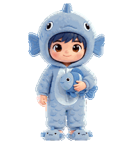
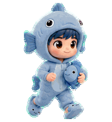
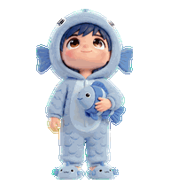
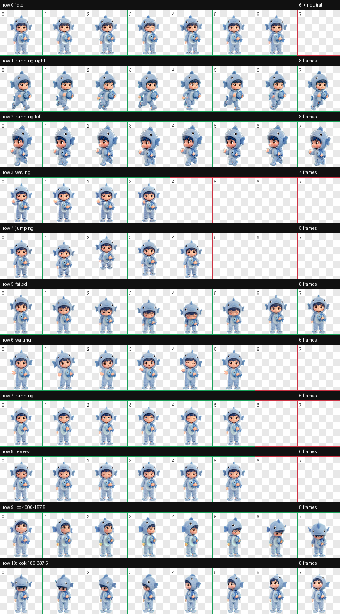
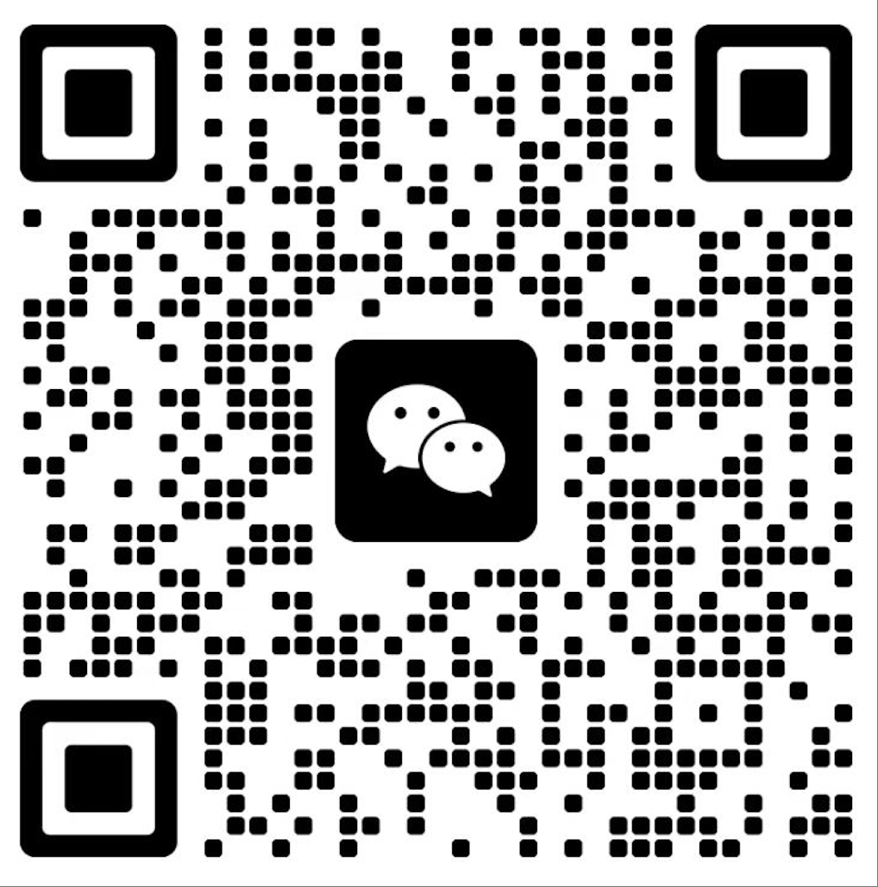

# 冰鱼仔 · Codex 桌面宠物

穿着浅蓝毛绒鱼服、抱着条纹小鱼的少年，安静陪你写代码。包含 **9 组动作、16 个注视方向**，使用 Codex V2 透明图集。

<p align="center">
  
  
  
</p>

## 安装

1. 从 [Releases](https://github.com/yeyoushen-03/codex-bingyuzi-pet/releases/latest) 下载 `bingyuzi-codex-v2.zip`，解压得到 `little-blue-fish` 文件夹。
2. 将该文件夹复制到 Codex 数据目录的 `pets/` 下。默认安装路径如下：

   | 系统 | 配置文件位置 |
   | --- | --- |
   | macOS / Linux | `~/.codex/pets/little-blue-fish/pet.json` |
   | Windows | `%USERPROFILE%\.codex\pets\little-blue-fish\pet.json` |

   若设置了 `CODEX_HOME`，使用该目录下的 `pets/little-blue-fish/`。`pet.json` 和 `spritesheet.webp` 必须位于同一层，避免多嵌套一层目录。
3. 在 Codex 宠物列表中选择 **冰鱼仔**。如未刷新，重新打开列表或重启客户端；需要支持自定义 V2 宠物的 Codex 桌面版。

也可以克隆后安装（macOS / Linux）：

```sh
git clone https://github.com/yeyoushen-03/codex-bingyuzi-pet.git
mkdir -p "${CODEX_HOME:-$HOME/.codex}/pets/little-blue-fish"
cp codex-bingyuzi-pet/pet.json codex-bingyuzi-pet/spritesheet.webp "${CODEX_HOME:-$HOME/.codex}/pets/little-blue-fish/"
```

内部 ID 保留为 `little-blue-fish`，已有安装直接覆盖即可更新。

当前版本 **v1.0.10**：左跑改为原图拆层骨骼动画，固定头脸、上身和抱鱼位置，并加入与近腿反相的自由臂摆动。保留左向朝向、屏幕右侧抱鱼和原生帧时长；接受轻微纸偶式肩下楔形。最终 v2 校验和独立视觉复核通过，其他十行图集 RGBA 字节不变。

## 动作与注视方向

| 状态 | 动作 | 帧数 |
| --- | --- | ---: |
| 待机 `idle` | 轻微呼吸、自然眨眼 | 6 |
| 向右 `running-right` | 向右交替迈步 | 8 |
| 向左 `running-left` | 独立朝左交替步态，抱鱼保持原侧 | 8 |
| 挥手 `waving` | 温和挥手 | 4 |
| 跳跃 `jumping` | 蓄力、腾空、落地 | 5 |
| 失败 `failed` | 低头后恢复站姿 | 8 |
| 等待 `waiting` | 摊开空闲手，耐心等待 | 6 |
| 工作 `running` | 专注思考 | 6 |
| 复核 `review` | 倾头检查、思索 | 6 |

注视方向按顺时针排列，每隔 22.5° 一格；0° 向上，90° 向右，180° 向下，270° 向左。动作触发与方向选择由客户端控制。

[左右同步对比](assets/previews/left-right-synchronized.gif) · [全部动画预览](assets/previews/) · [16 个方向](assets/look-directions.png) · [原图配色对照](assets/palette-comparison.png)



## 规格与验证

- `spriteVersionNumber: 2`，无损透明 WebP，1536×2288。
- 8 列 × 11 行，每格 192×208；57 个动作帧、16 个方向、1 个默认正面姿势。
- 浅蓝衣服与深蓝装饰均以参考图做了配色校准，保留毛绒纹理、暖肤色与条纹。
- 图集尺寸、单元、透明边缘已通过校验；制作阶段通过独立动作检查、配色检查和三份隔离方向盲审。
- 少数中间方向的次要分量较轻，生成光照与参考图略有差异。
- 已检查实际尺寸的全部动作播放和跨状态切换；原生客户端内的实际显示尚未验证。

验收记录见 [docs/qa](docs/qa/)。素材基于提供的角色参考，由 AI 辅助生成与整理。

## 作者与交流

作者：[yeyoushen-03](https://github.com/yeyoushen-03)

欢迎技术交流


